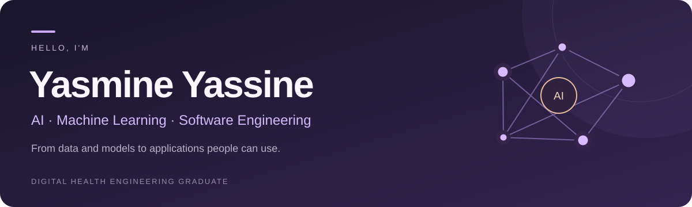

  

  

  <a href="https://yasmine712.github.io/YASMINE712/"><strong>Get to know me and explore my portfolio</strong></a> ·
  <a href="https://www.linkedin.com/in/yasmine-yassine-21ab61285/">LinkedIn</a> ·
  <a href="https://github.com/YASMINE712?tab=repositories">Repositories</a>

## Get to know me

I am a recent Digital Health Engineering graduate focused on AI, data, and software engineering. I enjoy turning a concrete workflow into working software: preparing data, training and evaluating a model, then integrating it into an application that people can use.

## Selected public projects

| Project | Verified public evidence |
| :--- | :--- |
| **[OncoSense](https://github.com/YASMINE712/OncoSense)** | Breast-cancer computer-vision case study with image-manifest preparation, CNN classifier candidates, lesion localisation, augmentation and contextual crops. Private internship code, data and weights are excluded. |
| **[ProCardio](https://github.com/YASMINE712/procardio-showcase)** | Public engineering case study for a multi-tenant cardiology workflow, document processing and retrieval-assisted assistance, reporting automation, and reviewed computer-vision suggestions. The source remains private. |
| **[My Health Friend](https://github.com/YASMINE712/patient-engagement-system)** | Flask and scikit-learn project with participant-aware data preparation, Random Forest and Ridge baselines, evaluation figures, and contextual-bandit simulation. |
| **[MedRec CareFlow](https://github.com/YASMINE712/medrec-careflow)** | Flask workflow application with authenticated roles, encrypted fields, ML fixture training, tests, Docker, and GitHub Actions delivery checks. |
| **[HayatCare](https://github.com/YASMINE712/HAYAT-CARE)** | Flask prototype with optional YOLOv8 detection, Gemini API integration, local persistence, reminders, and research-model demonstrations. |

## Demonstrated toolkit

**Python and data:** Python · Pandas · NumPy · scikit-learn · SQLite · CSV/data validation

**AI and ML:** PyTorch and Torchvision · YOLOv8 · transfer learning · Logistic Regression · Random Forest · Ridge · model evaluation · image processing

**Software delivery:** Flask · HTML/CSS/JavaScript · Docker · Git/GitHub · GitHub Actions · automated tests · report generation

## Experience

- **Ciprotec · Final-year engineering internship · Feb–Jul 2026** — contributed to software development, workflow automation, and computer vision for ProCardio.
- **Cheikh Khalifa International University Hospital · Jul–Aug 2025** — worked on deep-learning image-classification activities covering data preparation, training, evaluation, and integration.
- **UM6SS Biomedical Experimentation Center · Jul 2024** — technical observation internship in imaging workflows, 3D modeling, and digital prototyping.

I work in French and English, and I am looking for junior opportunities where AI, data preparation, and practical software engineering meet.
